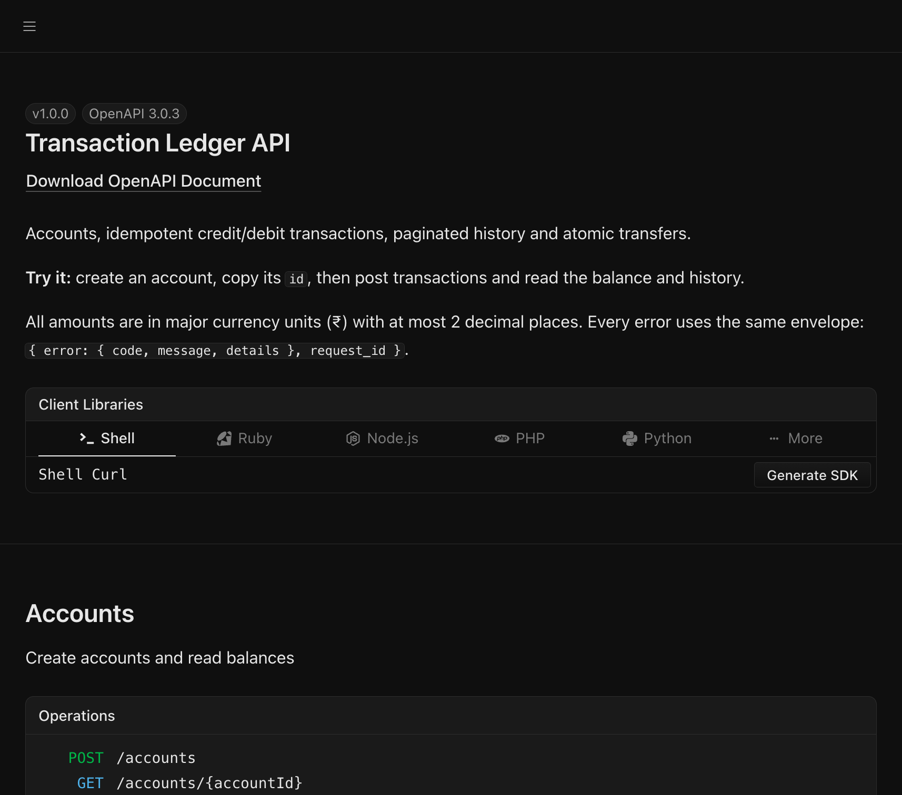
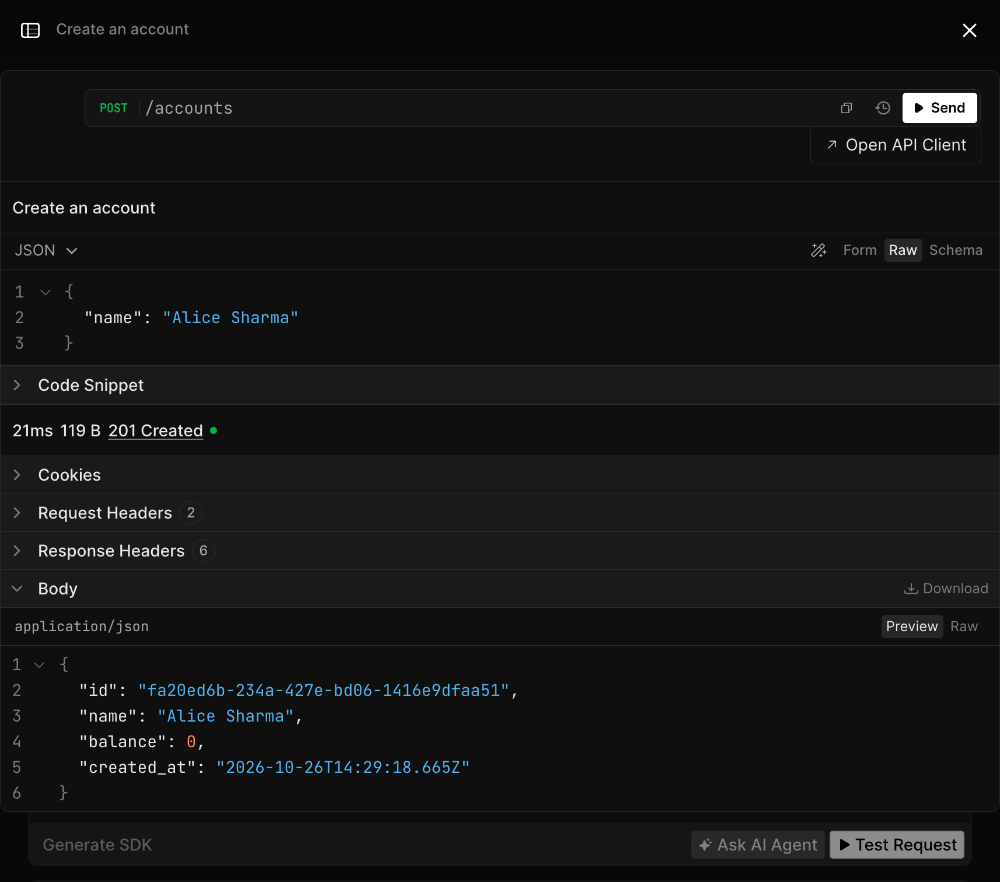

# Transaction Ledger API

A backend for a simple transaction ledger: create accounts, post idempotent credits and debits, read balances and paginated history, and move money between accounts atomically.

Built with **TypeScript · Fastify · Zod · SQLite (better-sqlite3) · Vitest**.

- **Zero setup.** `npm install && npm run dev` gives you a working API with interactive docs. No database server, Docker or env file needed.
- **Correctness enforced twice.** Every rule is checked in the service layer *and* backed by a database constraint or trigger, so a bug in one layer cannot corrupt the ledger.
- **71 automated tests**, including concurrency, atomicity (injected failures mid-write) and a randomized ledger-invariant check.
- **Self-documenting.** The OpenAPI spec is generated from the same Zod schemas that validate requests, so docs cannot drift from behaviour.

| Submission item    | Where                                                                                   |
| ------------------ | --------------------------------------------------------------------------------------- |
| Source code        | [`src/`](src), tests in [`tests/`](tests)                                               |
| README             | this file                                                                               |
| API documentation  | [`docs/API.md`](docs/API.md), interactive docs at `/docs` (Scalar) and `/swagger` (Swagger UI), [`docs/openapi.json`](docs/openapi.json) |
| Assumptions        | [`docs/ASSUMPTIONS.md`](docs/ASSUMPTIONS.md)                                            |

---

## Quick start

Requires **Node.js 20+** (tested on Node 24).

```bash
npm install
npm run dev          # http://localhost:3000, docs at http://localhost:3000/docs
```

In a second terminal, run a guided walkthrough of every scenario in the brief:

```bash
npm run demo         # BASE_URL=http://localhost:3000 by default
```

Or try it by hand:

```bash
ACC=$(curl -s -X POST localhost:3000/accounts -H 'content-type: application/json' \
  -d '{"name":"Alice"}' | node -pe 'JSON.parse(require("fs").readFileSync(0)).id')

curl -s -X POST localhost:3000/accounts/$ACC/transactions -H 'content-type: application/json' \
  -d '{"type":"credit","amount":100,"reference_id":"salary-oct","description":"October salary"}'

curl -s localhost:3000/accounts/$ACC/balance
curl -s "localhost:3000/accounts/$ACC/transactions?type=credit&page=1&limit=10"
```

### Scripts

| Command             | What it does                                         |
| ------------------- | ---------------------------------------------------- |
| `npm run dev`       | Start with hot reload and pretty logs                |
| `npm test`          | Run the full test suite (in-memory database)         |
| `npm run typecheck` | Strict TypeScript check                              |
| `npm run build`     | Compile to `dist/`                                   |
| `npm start`         | Run the compiled build (`NODE_ENV=production` for JSON logs) |
| `npm run demo`      | Walk through the brief's scenarios against a running server |
| `npm run openapi`   | Regenerate `docs/openapi.json`                       |

### Configuration

All optional; see [`.env.example`](.env.example).

| Variable        | Default          | Notes                                         |
| --------------- | ---------------- | --------------------------------------------- |
| `PORT`          | `3000`           |                                               |
| `HOST`          | `0.0.0.0`        |                                               |
| `DATABASE_PATH` | `data/ledger.db` | Created on first run. `:memory:` for a throwaway DB |
| `LOG_LEVEL`     | `info`           | Pino log level                                |

---

## API at a glance

| Method                 | Path                                          | Purpose                                   |
| ---------------------- | --------------------------------------------- | ----------------------------------------- |
| `POST`                 | `/accounts`                                   | Create an account (balance always 0)      |
| `GET`                  | `/accounts/:accountId`                        | Get an account                            |
| `GET`                  | `/accounts/:accountId/balance`                | Get current balance                       |
| `POST`                 | `/accounts/:accountId/transactions`           | Add a credit or debit                     |
| `GET`                  | `/accounts/:accountId/transactions`           | History: `type`, `page`, `limit`; latest first |
| `GET`                  | `/accounts/:accountId/transactions/:id`       | Get one transaction                       |
| `PUT` `PATCH` `DELETE` | `/accounts/:accountId/transactions/:id`       | Always `405`: transactions are immutable  |
| `POST`                 | `/transfers`                                  | **Bonus:** atomic transfer between accounts |
| `GET`                  | `/transfers/:transferId`                      | Get a transfer with both ledger legs      |
| `GET`                  | `/health`                                     | Liveness + DB check                       |

Every error uses one envelope:

```json
{
  "error": { "code": "INSUFFICIENT_BALANCE", "message": "Insufficient balance to complete the debit",
             "details": { "account_id": "…", "balance": 100, "requested_amount": 150 } },
  "request_id": "6f1c…"
}
```

Full reference with examples and every error code: **[docs/API.md](docs/API.md)**.

### Try it in the browser

Open **`/docs`** for an interactive API reference ([Scalar](https://scalar.com)). Every endpoint has a **Test Request** button that sends a real request with pre-filled example data and shows the response. The classic Swagger UI is also available at `/swagger`.





---

## How each requirement is guaranteed

| Requirement                        | Application layer                                                   | Database layer                                       | Test |
| ---------------------------------- | ------------------------------------------------------------------- | ---------------------------------------------------- | ---- |
| Unique IDs                         | `crypto.randomUUID()`                                               | `PRIMARY KEY`                                        | `accounts.test.ts` |
| Client can't set balance / id / timestamps | Strict request schema rejects unknown fields with `400`     | `balance DEFAULT 0`, `created_at DEFAULT now`        | `accounts.test.ts` |
| Debit never overdraws              | Balance check before writing → `422 INSUFFICIENT_BALANCE`           | `CHECK (balance >= 0)`, `CHECK (balance_after >= 0)` | `transactions.test.ts`, `integrity.test.ts` |
| Duplicate `reference_id` per account | Lookup inside the write transaction → `409` with the original transaction | `UNIQUE (account_id, reference_id)`              | `transactions.test.ts` |
| Same `reference_id` on other accounts | Uniqueness is scoped to the account                              | Composite unique key                                 | `transactions.test.ts` |
| Valid type / positive amount       | Zod: `enum`, `> 0`, ≤ 2 decimals, upper bound                       | `CHECK (type IN …)`, `CHECK (amount > 0)`            | `transactions.test.ts` |
| Transactions immutable             | No update/delete code paths; `PUT`/`PATCH`/`DELETE` → `405`         | `BEFORE UPDATE` / `BEFORE DELETE` triggers abort     | `transactions.test.ts`, `integrity.test.ts` |
| Atomic balance + entry             | Both writes in one `BEGIN IMMEDIATE` transaction                    | SQLite transaction (rollback on any throw)           | `integrity.test.ts` (injected failure) |
| Balance = sum of valid transactions | Single write path (`Ledger.post`); each entry stores `balance_after` | Constraints above                                   | randomized 300-op invariant test |
| Concurrency safety                 | `IMMEDIATE` transactions serialise writers                          | `busy_timeout` + WAL                                 | 25 concurrent debits, 10 concurrent duplicates |
| Atomic transfer, no partial state  | Both legs + transfer row in one transaction                         | `CHECK (from <> to)`, FKs                            | `transfers.test.ts` (credit leg crash → full rollback) |

---

## Architecture

```
src/
├── server.ts                 # Process entry: config, DB, listen, graceful shutdown
├── app.ts                    # buildApp(): wires repositories → services → routes (used by tests too)
├── config.ts
├── db/
│   ├── database.ts           # Opens SQLite, sets pragmas, runs migrations
│   └── migrations.ts         # Versioned, append-only schema (constraints + triggers)
├── lib/                      # Framework-agnostic helpers
│   ├── errors.ts             # AppError + typed error factory
│   ├── money.ts              # Major ↔ minor unit conversion, amount validation
│   ├── pagination.ts
│   └── http-schemas.ts       # Shared Zod schemas (error envelope, ids, reference_id…)
├── plugins/
│   ├── error-handler.ts      # Maps every failure to the error envelope
│   └── docs.ts               # OpenAPI spec + Scalar (/docs) + Swagger UI (/swagger)
└── modules/
    ├── accounts/             # routes · service · repository · schemas
    ├── transactions/
    │   ├── ledger.ts         # ← the ONLY code that moves money
    │   └── …                 # routes · service · repository · schemas
    └── transfers/            # routes · service · repository · schemas
```

**Request flow:** `route` (HTTP + Zod validation) → `service` (business rules, owns the DB transaction) → `Ledger.post` (balance check + write) → `repository` (prepared SQL statements).

The key design choice is that **every balance change goes through `Ledger.post`**. It doesn't open a transaction itself; its caller does. So a single transaction wraps one call, and a transfer wraps two calls plus the transfer record in one atomic unit. The rules for "what makes a valid posting" live in exactly one place.

---

## Design decisions and trade-offs

**Money is stored as integer minor units (paise).** `0.1 + 0.2 !== 0.3` in floating point, so the database never sees a float. The API speaks major units (`150.75`) for readability and validates at most 2 decimal places, then converts exactly once at the boundary.

**Each entry records `balance_after`.** It costs one column and makes the ledger auditable: you can replay or spot-check any point in history without recomputing from scratch, and the running balance is visible in the history response.

**Duplicates return `409` with the original transaction.** That tells the client "already applied", which is what a retrying client needs to know, and the body gives it the result without a second request. Rejected (`4xx`) attempts are not stored, so a client can fix the request and retry with the same `reference_id`.

**Validation is strict.** Unknown fields such as `balance` on account creation are rejected rather than silently ignored, so a client never believes it set something it didn't.

**SQLite over Postgres for this submission.** The brief allows any database, and the priority was that a reviewer can run it in one command. SQLite gives real ACID transactions, CHECK/UNIQUE/FK constraints and triggers. `BEGIN IMMEDIATE` takes the write lock up front, so the read-check-write sequence cannot interleave with another writer. The schema is plain SQL that ports directly to Postgres.

**Offset pagination.** It is what the brief asks for (`page`/`limit`, total pages). Count and page are read in the same snapshot, so the metadata always matches the data.

### What I'd change for production

- **Postgres** with `SELECT … FOR UPDATE` on the account row (or a conditional `UPDATE … WHERE balance >= $amount`) to serialise per-account instead of per-database. Transfers would lock both rows in a consistent order (e.g. sorted by id) to avoid deadlocks.
- **Idempotency with a request fingerprint:** store a hash of the payload with the `reference_id`. Replay with the same payload → return the original `201`; same key with a different payload → `422`. (Today both return `409`; see assumptions.)
- **Cursor (keyset) pagination** on `(created_at, id)` for large histories, since `OFFSET` gets slower as you page deeper.
- **Auth and account ownership**, rate limiting, multi-currency (`currency` column with per-currency minor units), and an outbox table to publish `transaction.created` events reliably.
- **Periodic reconciliation job** asserting `accounts.balance = SUM(ledger)` for every account, with alerting.

---

## Testing

```bash
npm test
```

```
 Test Files  5 passed (5)
      Tests  71 passed (71)
```

Each test gets a fresh in-memory database and drives the real app through `app.inject()` (full HTTP pipeline, no network). Highlights:

- **Brief scenarios verbatim:** 100 + 50 − 30 − 20 = 100, insufficient debit leaves 100, transfer A 100→70 / B 50→80.
- **Concurrency:** 25 parallel debits of 10 against a balance of 100 → exactly 10 succeed, balance ends at 0. 10 parallel requests with one `reference_id` → exactly one succeeds.
- **Atomicity:** the ledger-entry write is made to fail *after* the balance update; the balance is still unchanged. For a transfer, the credit leg is made to crash *after* the debit; both accounts and the transfers table are unchanged.
- **Invariant:** 300 random credits/debits (with forced duplicates and overdrafts), then assert `balance = Σcredits − Σdebits = last balance_after ≥ 0`.
- **Database guarantees:** direct SQL `UPDATE`/`DELETE` on a transaction is refused by triggers; a negative balance or duplicate reference is refused by constraints.

See **[docs/ASSUMPTIONS.md](docs/ASSUMPTIONS.md)** for the interpretation choices behind these behaviours.
